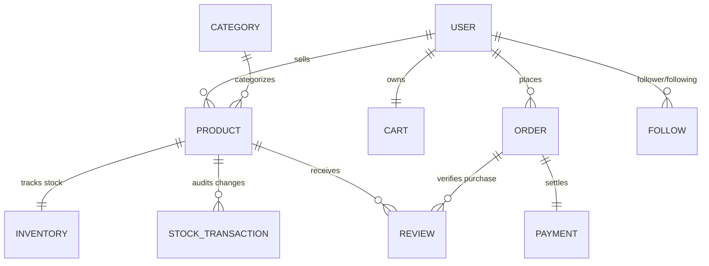
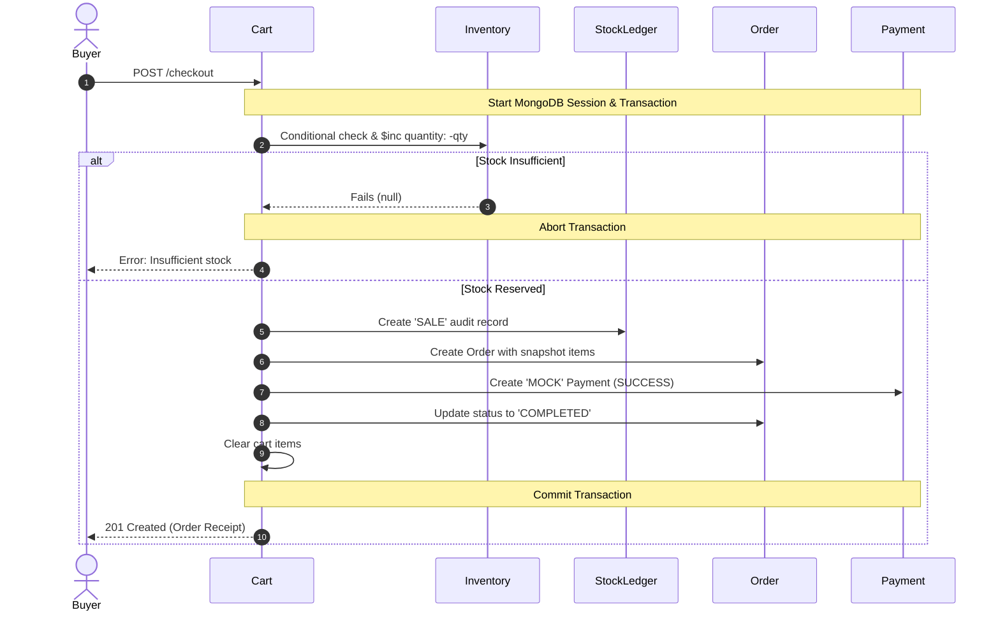

#  CampusStore (CampusStoreX) — Backend Architecture & Engineering Guide

> **CampusStore** is a specialized, database-first backend marketplace engineered for university students to buy, sell, and manage campus merchandise (textbooks, calculators, electronics, lab equipment, and stationery).

---

##  Table of Contents
1. [Core Learning Philosophy](#1-core-learning-philosophy)
2. [Database-First Architectural Decisions](#2-database-first-architectural-decisions)
3. [The 10 Master Collections & Schemas](#3-the-10-master-collections--schemas)
4. [System Relationship & Data Flow Architecture](#4-system-relationship--data-flow-architecture)
5. [Concurrency, Race Conditions & ACID Transactions](#5-concurrency-race-conditions--acid-transactions)
6. [Aggregation Analytics Engine](#6-aggregation-analytics-engine)
7. [Tech Stack & Package Ecosystem](#7-tech-stack--package-ecosystem)
8. [Folder & Feature Architecture](#8-folder--feature-architecture)
9. [Environment Setup & Installation](#9-environment-setup--installation)
10. [Related Guides](#10-related-guides)

---

## 1.  Core Learning Philosophy

CampusStore is intentionally engineered as **Database-First, not Feature-First**.
The backend answers the foundational system design question:

> *"When given a set of business requirements, how do you architect an optimal, consistent, and scalable MongoDB database?"*

### Explicit Scope Boundaries
To maintain a laser focus on database design, consistency, and indexing, the following real-world complexities are deliberately excluded:
- ❌ No third-party payment gateways (Stripe/Razorpay) — handled via audited `MOCK` transactions.
- ❌ No Kafka / WebSockets / Microservices / Elasticsearch.
- ❌ No multi-warehouse logistics, delivery tracking, auctions, or coupon discount engines.

---

## 2.  Database-First Architectural Decisions

Before writing schemas, 10 fundamental design choices were made:

| # | Architectural Question | Design Choice | Technical Rationale |
|---|---|---|---|
| 1 | **Why embed `specifications` inside `Product`?** | Embedded Subdocument (`_id: false`) | Specifications (edition, condition, author) share the exact lifecycle of the product, have a fixed size, and are always read whenever the product is queried. Eliminates costly `$lookup` joins. |
| 2 | **Why separate `Inventory` from `Product`?** | Normalized Reference (1:1) | Products are read-heavy (catalog browsing). Inventory is write-heavy (constant reservations and increments). Separating them avoids write contention and lock invalidations on catalog cache. |
| 3 | **Why embed `Cart.items`?** | Embedded Array (`items[]`) | A cart belongs to a single user, is read/updated as an atomic unit, and is strictly capped at 20 items. No unbounded growth risk. |
| 4 | **Why embed `Order.items`?** | Embedded Array (`items[]`) | An order and its line items are immutable historical records that are always retrieved together as a financial receipt. |
| 5 | **Why snapshot `name` and `price` in `Order`?** | Denormalization / Snapshot Data | Catalog prices change over time. If a textbook price increases next semester, past receipts must permanently retain the exact price paid at the time of purchase. |
| 6 | **Why reference `Reviews` instead of embedding?** | Normalized Reference (1:N) | A popular product can accumulate thousands of reviews. Embedding reviews creates the **Unbounded Array Anti-Pattern**, risking MongoDB's 16MB document limit. |
| 7 | **Why give `Follows` its own collection?** | Junction Collection ($N:M$) | Storing followers arrays in User documents causes high write contention and document ballooning. A dedicated collection provides isolated, fast indexed lookups. |
| 8 | **Why compound unique index on `follower + following`?** | Database-Level Constraint | Prevents race conditions and guarantees that a student can never follow the same seller more than once. |
| 9 | **Why calculate `averageRating` dynamically?** | Derived State via Aggregation | Rating is computed on the fly via `$avg` in an aggregation pipeline to avoid data drift and desynchronization. |
| 10 | **What happens if a product is deleted?** | Soft Delete (`status: 'INACTIVE'`) | Hard deletion breaks historical orders, stock transaction logs, and buyer reviews. Soft deletion preserves foreign-key referential integrity. |

---

## 3.  The 10 Master Collections & Schemas

### 1. `users`
- **Role**: Buyer, Seller, and Admin accounts.
- **Fields**: `name`, `email` (unique), `password` (hashed, `select: false`), `bio`, `role` (`'user' | 'admin'`), reset tokens.
- **Index**: `{ email: 1 }` (unique).

### 2. `categories`
- **Role**: Standardized taxonomy organizing campus items.
- **Fields**: `name` (unique, trimmed), `description`, `isActive`.
- **Index**: `{ name: 1 }` (unique).

### 3. `products`
- **Role**: Central marketplace catalog items.
- **Fields**: `name`, `description`, `price`, `category` (ref: Category), `seller` (ref: User), `specifications` (embedded), `status` (`'ACTIVE' | 'INACTIVE' | 'SOLD_OUT'`).
- **Indexes**:
  - `{ category: 1, status: 1 }` (compound catalog filter)
  - `{ seller: 1 }` (seller storefront query)
  - `{ price: 1 }` (range filtering and sorting)
  - `{ status: 1 }`

### 4. `inventory`
- **Role**: Real-time stock state per product (1-to-1).
- **Fields**: `product` (ref: Product, unique), `quantity` ($\ge 0$), `reserved` ($\ge 0$).
- **Derived Virtual**: `available = quantity - reserved`.
- **Index**: `{ product: 1 }` (unique).

### 5. `stockTransactions`
- **Role**: Immutable append-only audit ledger of every inventory change.
- **Fields**: `product` (ref: Product), `type` (`'PURCHASE' | 'SALE' | 'RETURN' | 'DAMAGE' | 'ADJUSTMENT'`), `quantity`, `reason`, `performedBy` (ref: User), `createdAt`.
- **Index**: `{ product: 1, createdAt: -1 }` (audit log lookup).

### 6. `follows`
- **Role**: Many-to-Many ($N:M$) relationship between students and sellers.
- **Fields**: `follower` (ref: User), `following` (ref: User), `createdAt`.
- **Indexes**:
  - `{ follower: 1, following: 1 }` (compound unique constraint)
  - `{ following: 1 }` (list seller's followers)

### 7. `carts`
- **Role**: Active shopping basket per user (1-to-1).
- **Fields**: `user` (ref: User, unique), `items` (embedded array of `{ product, quantity }`, capped at 20 items).
- **Index**: `{ user: 1 }` (unique).

### 8. `orders`
- **Role**: Completed customer checkout documents.
- **Fields**: `user` (ref: User), `items` (embedded snapshot `{ product, name, price, quantity }`), `subtotal`, `total`, `status` (`'PLACED' | 'CONFIRMED' | 'CANCELLED' | 'COMPLETED'`).
- **Indexes**:
  - `{ user: 1, createdAt: -1 }` (customer order history)
  - `{ status: 1 }`

### 9. `payments`
- **Role**: Audit record of payment fulfillment (1-to-1 with Order).
- **Fields**: `order` (ref: Order, unique), `amount`, `method` (`'MOCK'`), `status` (`'SUCCESS' | 'FAILED'`), `transactionId` (unique).
- **Indexes**:
  - `{ order: 1 }` (unique)
  - `{ transactionId: 1 }` (unique)

### 10. `reviews`
- **Role**: Product ratings and reviews by verified buyers.
- **Fields**: `user` (ref: User), `product` (ref: Product), `order` (ref: Order), `rating` (1–5), `comment`.
- **Indexes**:
  - `{ user: 1, product: 1 }` (compound unique constraint)
  - `{ product: 1, createdAt: -1 }` (fetch reviews by date)

---

## 4.  System Relationship & Data Flow Architecture



---

## 5.  Concurrency, Race Conditions & ACID Transactions

CampusStore implements two layers of protection against race conditions and overselling:

### 1. Atomic Conditional Updates
When reserving or deducting inventory outside a multi-step workflow:
```javascript
const inventory = await Inventory.findOneAndUpdate(
  {
    product: productId,
    quantity: { $gte: requestedQty } // Atomic gate: prevents negative stock
  },
  { $inc: { quantity: -requestedQty } },
  { returnDocument: 'after' }
);
```

### 2. Multi-Document ACID Transactions (Checkout Pipeline)
During checkout, operations span 5 collections (`Cart`, `Inventory`, `StockTransaction`, `Order`, `Payment`). A MongoDB Session guarantees that all operations either commit together or roll back completely:



---

## 6.  Aggregation Analytics Engine

All reporting and metrics are computed dynamically using MongoDB Aggregation Pipelines:

1. **Average Product Rating**:
   `Reviews` $\to$ `$match` (product) $\to$ `$group` (`$avg: '$rating'`)
2. **Total Platform Sales**:
   `Orders` $\to$ `$match` (`COMPLETED`) $\to$ `$group` (`$sum: '$total'`, `$sum: 1`)
3. **Best-Selling Products**:
   `Orders` $\to$ `$unwind: '$items'` $\to$ `$group` (by product ID, `$sum: '$items.quantity'`) $\to$ `$sort` (descending) $\to$ `$limit`
4. **Sales By Category**:
   `Orders` $\to$ `$unwind: '$items'` $\to$ `$lookup` (`products`) $\to$ `$unwind` $\to$ `$lookup` (`categories`) $\to$ `$unwind` $\to$ `$group` (by category, `$sum: revenue`)
5. **Seller Revenue**:
   `Orders` $\to$ `$unwind: '$items'` $\to$ `$lookup` (`products`) $\to$ `$match` (`product.seller`) $\to$ `$group` (`$sum: revenue`)
6. **User Spending History**:
   `Orders` $\to$ `$match` (`user`, `COMPLETED`) $\to$ `$group` (`$sum: '$total'`)
7. **Product Stock Breakdown**:
   `StockTransactions` $\to$ `$match` (product) $\to$ `$group` (by `type`, `$sum: '$quantity'`)

---

## 7.  Tech Stack & Package Ecosystem

| Technology / Package | Version | Architectural Responsibility |
|---|---|---|
| **Node.js** | $\ge 20.0$ | ES Modules runtime (`"type": "module"`) |
| **Express** | `^5.2.1` | REST API routing and middleware composition |
| **Mongoose** | `^9.11.0` | Schema validation, virtuals, indexes, aggregation, ACID sessions |
| **ioredis** | `^6.0.0` | In-memory Redis store for multi-device session management and token rotation |
| **jsonwebtoken** | `^9.0.3` | Access & refresh token signing and verification |
| **bcrypt** | `^5.1.1` | Password salting and hashing (salt rounds: 12) |
| **nodemailer** | `^10.0.15` | Password reset email delivery |
| **dotenv** | `^18.0.6` | Environment variable management |
| **cookie-parser** | `^1.4.7` | HttpOnly cookie parsing for secure refresh tokens |

---

## 8.  Folder & Feature Architecture

```
campusStoreX/
├── src/
│   ├── app.js                          # Express app configuration & route mounting
│   ├── server.js                       # Server initialization & DB connection
│   ├── config/
│   │   ├── db.js                       # MongoDB connection via Mongoose
│   │   └── redis.js                    # Redis client initialization (ioredis)
│   ├── features/
│   │   ├── auth/                       # Authentication & Redis session management
│   │   ├── users/                      # User profile queries
│   │   ├── categories/                 # Category taxonomy management
│   │   ├── products/                   # Products catalog & embedded specs
│   │   ├── inventory/                  # Stock state & immutable transactions ledger
│   │   ├── follows/                    # Many-to-many seller follow system
│   │   ├── cart/                       # User carts with embedded items
│   │   ├── orders/                     # Orders with snapshot items & ACID checkout
│   │   ├── payment/                    # Audited mock payment records
│   │   ├── reviews/                    # Verified-purchase reviews & rating stats
│   │   └── analystics/                 # Aggregation analytics pipelines
│   ├── middlewares/
│   │   └── error.middleware.js         # Global error handler
│   ├── stores/
│   │   └── redis.sessions.store.js     # Redis device session helpers
│   └── utils/
│       ├── appError.js                 # Operational error class
│       ├── catchAsync.js               # Async handler wrapper
│       ├── deviceInfo.js               # Device and user-agent metadata parser
│       ├── sendEmail.js                # Nodemailer email transport
│       └── token.js                    # JWT access/refresh token generators & hashers
├── package.json
└── README.md
```

---

## 9.  Environment Setup & Installation

### 1. Prerequisites
- Node.js $\ge 20$
- MongoDB $\ge 6.0$ (running as a Replica Set if using multi-document transactions)
- Redis $\ge 6.0$

### 2. Configure `.env`
Create a `.env` file in the root directory:
```env
PORT=3000
MONGO_URI=mongodb://127.0.0.1:27017/campusStoreX?replicaSet=rs0
ACCESS_TOKEN_SECRET=your_jwt_access_secret_key_here
REFRESH_TOKEN_SECRET=your_jwt_refresh_secret_key_here
REDIS_URI=redis://127.0.0.1:6379
EMAIL_USER=your_email@gmail.com
EMAIL_PASSWORD=your_gmail_app_password
FRONTEND_URL=http://localhost:5173
```

### 3. Install & Run
```bash
# Install dependencies
npm install

# Start the application
npm start
```

---

