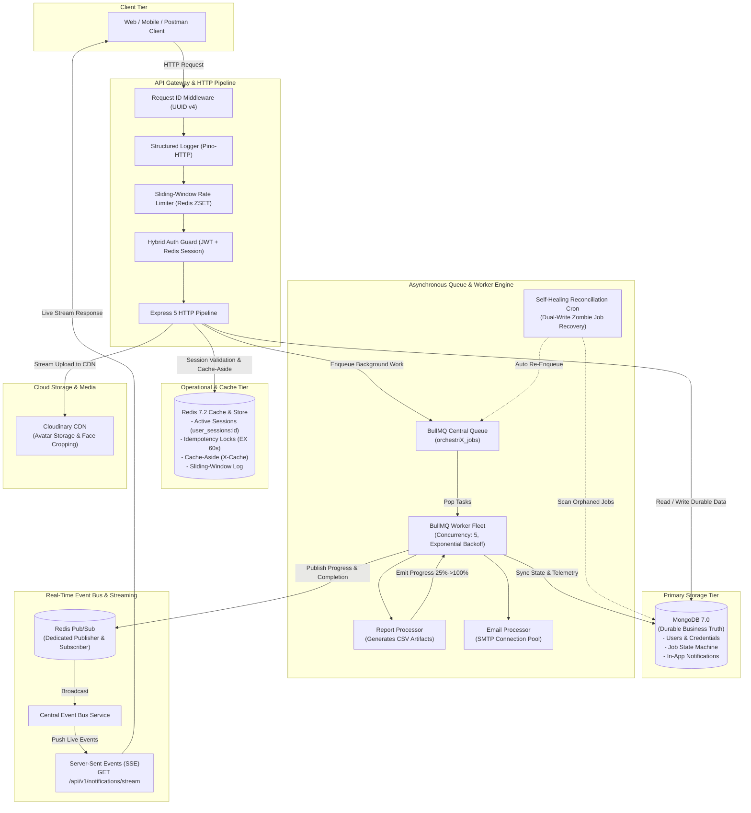

# OrchestriX-8 — Distributed Job Orchestration, Real-Time Event Streaming & Hybrid Auth Engine

> **OrchestriX-8** is an enterprise-grade, event-driven backend platform engineered to demonstrate production-grade distributed architectures, asynchronous queue processing, real-time client streaming, fault-tolerant self-healing systems, and zero-downtime resilience beyond simple CRUD operations.

Built with **Node.js (ES Modules)**, **Express**, **MongoDB (Mongoose)**, **Redis (ioredis)**, and **BullMQ**.

---

##  System Architecture



---

##  Key Architectural Modules

### 1. Hybrid Authentication & Multi-Device Session Store
* **Stateless Speed + Stateful Control**: Routine API calls authenticate instantly via short-lived, encrypted JWT `accessToken` stored in an `httpOnly`, `sameSite: Lax` cookie with zero database lookups.
* **Stateful Device Tracking**: Stateful `sessionId` (UUID v4) lives in Redis under `session:${sessionId}` (7-day TTL) and is indexed in `user_sessions:${userId}` (Redis Set).
* **Deterministic Dashboard Sorting**: `GET /api/v1/auth/sessions` always pins `isCurrentDevice: true` to index 0, sorting all other devices from newest to oldest (`createdAt: -1`).
* **Refresh Token Rotation (RTR) with Breach Detection**: Refreshing a session generates a new cryptographic token and rotates the stored hash using Redis `KEEPTTL`. If an old token is reused, the session is instantly terminated.
* **Instant Global Revocation**: Calling `DELETE /api/v1/auth/sessions` or resetting a password atomically purges all active sessions across all devices simultaneously.

### 2. Decoupled Asynchronous Queue & Worker Engine (BullMQ)
* **Sub-10ms API Responses**: Heavy computational operations (financial summaries, data exports, email delivery) are decoupled from the HTTP cycle via BullMQ (`orchestriX_jobs`).
* **Worker Concurrency**: Runs with `concurrency: 5` to process up to 5 parallel tasks per worker node.
* **Exponential Backoff**: Transient failures automatically retry with exponential backoff (`2s -> 4s -> 8s`, maximum 3 attempts).
* **State Machine Synchronization**: Maps internal queue lifecycles directly into MongoDB (`QUEUED` $\rightarrow$ `PROCESSING` $\rightarrow$ `COMPLETED` / `FAILED`).

### 3. Real-Time Multi-Stage Progress Streaming via SSE & Redis Pub/Sub
* **Server-Sent Events (SSE)**: Native HTTP streaming (`text/event-stream`) via `GET /api/v1/notifications/stream` with zero client-side socket libraries required.
* **Redis Pub/Sub Event Bus**: Dedicated `redisPublisher` and `redisSubscriber` client instances decouple background worker nodes from HTTP API instances.
* **Live Progress Bar Telemetry**: Long-running processors report incremental milestones (`25% -> 50% -> 75% -> 100%`) through BullMQ progress events, broadcasting live updates to client screens in `< 5ms`.
* **Safe Socket Disposal**: Heartbeat keep-alives (`: keep-alive\n\n`) every 25 seconds prevent proxy timeouts, with safe writers preventing `ERR_STREAM_DESTROYED` crashes on client disconnects.

### 4. Sliding-Window Rate Limiting (Redis Sorted Sets)
* **Zero Boundary Bursts**: Unlike naive fixed-window counters (`INCR` + `EXPIRE`) that allow double quotas at window boundaries, OrchestriX implements a true **Sliding Window Log** algorithm using Redis Sorted Sets (`ZSET`).
* **Atomic Pipeline Execution**:
  1. `ZREMRANGEBYSCORE`: Evicts timestamps older than `now - windowSeconds`.
  2. `ZADD`: Adds current microsecond timestamp.
  3. `ZCARD`: Evaluates active requests inside the window.
  4. `EXPIRE`: Keeps the key alive for the window duration.
* **Per-Route Quotas**: Strict limiters on login (`auth_login`: 5 per 15 min), registration (`auth_register`: 5 per hour), password reset (`3 per 15 min`), job submissions (`job_create`: 10 per min per user), and global API traffic (`general_api`: 100 per min per IP).
* **Standard Headers**: Returns `X-RateLimit-Limit`, `X-RateLimit-Remaining`, `X-RateLimit-Reset`, and `Retry-After` on `429 Too Many Requests`.

### 5. Dual-Write Problem Resilience & Self-Healing Reconciliation Engine
* **The Distributed Dual-Write Dilemma**: Writing to MongoDB and queueing into Redis/BullMQ are independent operations. A network partition or process crash between step 1 and step 2 creates **"Zombie Jobs"** (persisted in DB as `QUEUED`, but missing in BullMQ).
* **Automated Reconciliation Cron**: A self-healing background worker scans MongoDB every 60 seconds for jobs older than 1 minute missing a `bullJobId`. It automatically re-enqueues them with original payload and priority, guaranteeing **at-least-once processing**.

### 6. Dead-Letter Queue (DLQ) & Bulk Failure Recovery
* **Dead-Letter Inspection**: `GET /api/v1/jobs/failed` exposes all permanently failed jobs with error stack traces, failed timestamps, and attempt counts.
* **One-Click Bulk Recovery**: `POST /api/v1/jobs/failed/retry-all` allows system administrators or users to re-enqueue all failed jobs in one shot once an external dependency recovers.

### 7. High-Throughput Cache-Aside & Invalidation Architecture
* **Cache-Aside Pattern**: `GET /api/v1/auth/profile` and `GET /api/v1/jobs/dashboard/stats` check Redis first (`GET cache:user:profile:...`). On cache hit, response returns in `< 2ms` with `X-Cache: HIT`.
* **Explicit Invalidation Hooks**: Updates to user profiles or avatars explicitly purge cached Redis keys (`DEL cache:user:profile:${userId}`), guaranteeing strong eventual consistency.
* **Fail-Open Strategy**: If Redis experiences latency or connection loss, caching and rate limiting gracefully degrade to database fallbacks without failing user requests.

### 8. Cloudinary Media Pipeline & Ephemeral Container Safety
* **Zero Disk Writes**: Ingests files into memory buffers using `multer.memoryStorage()`, streaming directly to Cloudinary via `streamifier`.
* **PaaS & Container Portability**: Containers deployed on serverless/ephemeral hosts (Render, Railway, Fly.io, Kubernetes) never lose user avatars upon container restarts.
* **Smart Face Cropping**: Uses Cloudinary's neural gravity algorithms (`gravity: 'face'`, `crop: 'thumb'`) with automatic old avatar cleanup.

---

##  Technology Stack

| Layer | Technology | Purpose |
|---|---|---|
| **Runtime** | Node.js (v20+ / v22+) | High-performance asynchronous JavaScript engine (ES Modules) |
| **Framework** | Express.js 5 | Robust web application framework |
| **Database** | MongoDB 7.0 | Authoritative persistent business data store |
| **ODM** | Mongoose 8.x | Schema validation, compound indexing, aggregation pipelines |
| **Cache & Queue Broker** | Redis 7.2 (ioredis) | Multi-device sessions, cache-aside, sliding window, idempotency |
| **Queue Engine** | BullMQ 5.x | Background worker management, retries, concurrency, job delays |
| **Pub/Sub Messaging** | Redis Pub/Sub | Distributed real-time event broadcasting across backend nodes |
| **Real-Time Client Stream** | Server-Sent Events (SSE) | Native one-way live event streaming (`text/event-stream`) |
| **Logging** | Pino & Pino-HTTP | High-throughput structured JSON logging with request tracing |
| **Security & Headers** | Helmet, Cookie-Parser, CORS | HTTP header hardening, secure cookie handling |
| **Validation** | Zod 4.x | Fail-fast schema validation for requests and environment variables |
| **File Processing** | Multer, Streamifier, Cloudinary | In-memory buffer ingestion and cloud media management |
| **Email Transport** | Nodemailer | SMTP connection pooling with startup credential verification |

---

##  Project Directory Structure

```
orchestriX-8/
├── artifacts/                           # Generated job artifacts (CSV reports, data dumps) [Git-ignored]
├── src/
│   ├── config/
│   │   ├── cloudinary.storage.js        # Cloudinary stream uploader & asset deletion
│   │   ├── db.js                        # Mongoose connector with lifecycle listeners
│   │   ├── email.js                     # Nodemailer SMTP connection pool & startup verification
│   │   ├── env.js                       # Zod fail-fast environment variable validation
│   │   ├── logger.js                    # Pino structured logger (pretty for dev, JSON for prod)
│   │   └── redis.js                     # Multi-instance Redis connections (Default, BullMQ, Pub, Sub)
│   ├── features/
│   │   ├── auth/                        # Hybrid authentication, session store, profile & avatar
│   │   │   ├── auth.controller.js
│   │   │   ├── auth.middleware.js
│   │   │   ├── auth.model.js
│   │   │   ├── auth.route.js
│   │   │   ├── auth.services.js
│   │   │   └── auth.validation.js
│   │   ├── jobs/                        # Asynchronous background job orchestration
│   │   │   ├── jobs.controller.js
│   │   │   ├── jobs.model.js
│   │   │   ├── jobs.route.js
│   │   │   └── jobs.validation.js
│   │   └── notifications/               # In-app notifications & SSE real-time stream
│   │       ├── notification.controller.js
│   │       ├── notification.model.js
│   │       ├── notification.route.js
│   │       └── notification.service.js
│   ├── middlewares/
│   │   ├── error.middleware.js          # Centralized error handler & AppError mapping
│   │   ├── rateLimiter.middleware.js    # Sliding-Window Rate Limiter using Redis Sorted Sets
│   │   ├── requestId.middleware.js      # Injects unique X-Request-ID (UUID v4) on every request
│   │   └── upload.middleware.js         # Multer in-memory upload filter (JPEG/PNG/WebP, max 5MB)
│   ├── queues/
│   │   └── job.queue.js                 # Central BullMQ queue initialization & addJobToQueue helper
│   ├── routes/
│   │   └── health.route.js              # Liveness, readiness, DB, and Redis health probes
│   ├── services/
│   │   ├── email.service.js             # High-level email sending helper
│   │   ├── eventBus.service.js          # Central Redis Pub/Sub EventBus
│   │   └── reconciliation.service.js    # Self-healing zombie job reconciliation cron
│   ├── stores/
│   │   └── redis.sessions.store.js      # Low-level Redis multi-device session store
│   ├── templates/
│   │   └── email.template.js            # HTML & text fallback email layouts
│   ├── utils/
│   │   ├── appError.js                  # Operational error class with statusCode & isOperational
│   │   ├── cache.js                     # Redis cache-aside read/write/invalidation utilities
│   │   ├── catchAsync.js                # Async route wrapper eliminating try/catch boilerplate
│   │   ├── deviceInfo.js                # Extracts browser, OS, and IP fingerprints from req
│   │   └── token.js                     # Cryptographic token generation & SHA-256 hashing
│   ├── workers/
│   │   ├── job.worker.js                # BullMQ worker process, concurrency & progress listeners
│   │   └── processors/
│   │       ├── email.processor.js       # Asynchronous email delivery worker
│   │       └── report.processor.js      # Multi-stage CSV report generator with progress reporting
│   ├── app.js                           # Express application setup, security middlewares, route mounting
│   └── server.js                        # Bootstrap, database connections, cron startup & graceful shutdown
├── .env.example
├── .gitignore
├── docker-compose.yml
├── package.json
└── README.md
```

---

##  Environment Variables Configuration

Copy `.env.example` to `.env` in the `orchestriX-8` folder:

```bash
cp .env.example .env
```

| Variable | Description | Example / Default |
|---|---|---|
| `PORT` | HTTP Server port | `3000` |
| `NODE_ENV` | Application environment | `development` / `production` |
| `FRONTEND_URL` | Client origin for CORS & cookies | `http://localhost:5173` |
| `MONGO_URI` | MongoDB connection string | `mongodb://localhost:27017/orchestrix` |
| `REDIS_URI` | Redis connection string | `redis://localhost:6379` |
| `ACCESS_TOKEN_SECRET` | Secret key for signing short-lived JWTs | `your_super_secret_jwt_access_key` |
| `REFRESH_TOKEN_SECRET` | Secret key for refresh token integrity | `your_super_secret_refresh_key` |
| `CLOUDINARY_CLOUD_NAME`| Cloudinary cloud identification | `your_cloudinary_cloud_name` |
| `CLOUDINARY_API_KEY` | Cloudinary API Key | `your_cloudinary_api_key` |
| `CLOUDINARY_API_SECRET`| Cloudinary API Secret | `your_cloudinary_api_secret` |
| `EMAIL_HOST` | SMTP server host | `smtp.gmail.com` |
| `EMAIL_PORT` | SMTP port | `587` |
| `EMAIL_USER` | SMTP username | `your_email@gmail.com` |
| `EMAIL_PASSWORD` | SMTP App password (16 chars) | `xxxx xxxx xxxx xxxx` |
| `EMAIL_FROM` | Default outgoing sender name and email | `OrchestriX <no-reply@orchestrix.io>` |

---

##  API Endpoints Reference

### 1. Health & Readiness Probes
| Method | Endpoint | Description |
|---|---|---|
| `GET` | `/health/live` | Shallow probe checking if Node process is responsive |
| `GET` | `/health/ready` | Deep probe validating active connections to MongoDB & Redis |
| `GET` | `/health/database` | Direct MongoDB connection status |
| `GET` | `/health/redis` | Direct Redis PING / PONG status |

### 2. Hybrid Authentication & Multi-Device Sessions
| Method | Endpoint | Auth | Description |
|---|---|---|---|
| `POST` | `/api/v1/auth/register` | None | Register new user + background verification email |
| `POST` | `/api/v1/auth/login` | None | Log in, establish Redis session & issue cookies |
| `POST` | `/api/v1/auth/refresh` | None | Rotate refresh token preserving session TTL |
| `POST` | `/api/v1/auth/logout` | JWT | Terminate current device session in Redis |
| `GET` | `/api/v1/auth/profile` | JWT | Get user profile (Cache-Aside: `X-Cache: HIT/MISS`) |
| `PATCH`| `/api/v1/auth/update-profile` | JWT | Update profile + invalidates Redis profile cache |
| `PATCH`| `/api/v1/auth/change-password`| JWT | Change password + purges all sessions globally |
| `POST` | `/api/v1/auth/forgot-password`| None | Issue SHA-256 single-use password reset token |
| `POST` | `/api/v1/auth/reset-password/:token` | None | Reset password with token + global session purge |
| `GET` | `/api/v1/auth/verify-email/:token` | None | Verify account via email link |
| `POST` | `/api/v1/auth/resend-verification` | None | Resend verification email (Anti-enumeration) |
| `GET` | `/api/v1/auth/sessions` | JWT | View active devices sorted with `isCurrentDevice` |
| `DELETE`| `/api/v1/auth/sessions/:sessionId` | JWT | Remotely revoke a specific device session |
| `DELETE`| `/api/v1/auth/sessions` | JWT | Logout all devices everywhere |
| `PATCH`| `/api/v1/auth/avatar` | JWT | Upload avatar buffer directly to Cloudinary |

### 3. Asynchronous Jobs & Telemetry
| Method | Endpoint | Auth | Description |
|---|---|---|---|
| `POST` | `/api/v1/jobs` | JWT | Enqueue background job (Protected by RateLimiter) |
| `GET` | `/api/v1/jobs` | JWT | List user's jobs with filtering & pagination |
| `GET` | `/api/v1/jobs/failed` | JWT | Dead-Letter Queue (DLQ): view exhausted/failed jobs |
| `POST` | `/api/v1/jobs/failed/retry-all` | JWT | Bulk recovery: re-enqueue all failed jobs |
| `GET` | `/api/v1/jobs/dashboard/stats` | JWT | Aggregated job stats (Cached in Redis for 30s) |
| `GET` | `/api/v1/jobs/:jobId` | JWT | Inspect job status, live progress & execution time |
| `POST` | `/api/v1/jobs/:jobId/retry` | JWT | Retry a specific failed job |
| `GET` | `/api/v1/jobs/:jobId/result` | JWT | Download/stream generated CSV report artifact |
| `POST` | `/api/v1/jobs/:jobId/cancel` | JWT | Cancel a queued or active job |

### 4. Real-Time Notifications & Client Streaming
| Method | Endpoint | Auth | Description |
|---|---|---|---|
| `GET` | `/api/v1/notifications/stream` | JWT | **Server-Sent Events (SSE)** live real-time stream |
| `GET` | `/api/v1/notifications` | JWT | Get user notifications with pagination |
| `GET` | `/api/v1/notifications/unread-count` | JWT | Get count of unread notifications |
| `PATCH`| `/api/v1/notifications/read-all` | JWT | Mark all user notifications as read |
| `PATCH`| `/api/v1/notifications/:id` | JWT | Mark a single notification as read |
| `DELETE`| `/api/v1/notifications/:id` | JWT | Delete a specific notification |

---

##  Quick Start Guide

### 1. Start Infrastructure via Docker
Ensure Docker Desktop is running, then spin up MongoDB and Redis:
```bash
docker compose up -d
```

### 2. Install Dependencies
```bash
npm install
```

### 3. Launch Development Server
```bash
npm start
```

### 4. Verify Startup Telemetry
You should see clean structured startup logs:
```
[INFO]: Initializing services...
[INFO]: MongoDB connection established
[INFO]: Redis socket connected
[INFO]: Redis ready to accept commands
[INFO]: EventBus initialized and ready for messaging
[INFO]: EventBus: Subscribed to Redis channel: channel:notifications:user
[INFO]: SMPT transporter verified and ready to send emails
[INFO]: Self-healing reconciliation engine started
[INFO]: BullMQ Job worker started and waiting for tasks...
[INFO]: OrchestriX Server running on port 3000
```

---

##  Testing the Complete Real-Time Workflow

1. **Log in:** Send `POST http://localhost:3000/api/v1/auth/login`.
2. **Open Real-Time Stream (Postman Tab 1):**
   * Method: `GET`
   * URL: `http://localhost:3000/api/v1/notifications/stream`
   * Click **Send**. The connection will remain open:
     ```json
     data: {"type":"CONNECTED","message":"Real-time notification stream active"}
     ```
3. **Dispatch a Background Job (Postman Tab 2):**
   * Method: `POST`
   * URL: `http://localhost:3000/api/v1/jobs`
   * Body:
     ```json
     {
       "type": "REPORT_GENERATION",
       "priority": "HIGH"
     }
     ```
   * Send the request. You will immediately receive `202 Accepted`.
4. **Watch Tab 1 in Real-Time:**
   Without refreshing, observe the live progress stages stream in:
   ```json
   data: {"type":"JOB_PROGRESS","progress":25,"stage":"Querying transactional database"}
   data: {"type":"JOB_PROGRESS","progress":50,"stage":"Calculating revenue & tax aggregations"}
   data: {"type":"JOB_PROGRESS","progress":75,"stage":"Serializing dataset to CSV artifact"}
   data: {"type":"JOB_PROGRESS","progress":100,"stage":"Report generated successfully"}
   data: {"type":"NOTIFICATION","data":{"title":"Job Completed","type":"JOB_COMPLETED"}}
   ```
5. **Download Generated Artifact:**
   * Method: `GET`
   * URL: `http://localhost:3000/api/v1/jobs/<jobId>/result`
   * Automatically streams and downloads the actual CSV file.

---

##  Detailed Route-by-Route Blueprint

For the comprehensive, step-by-step making flow of **every single route** (including middleware pipeline, internal logic, packages used, and interview concepts), refer to the dedicated guide:

 [**OrchestriX Routes Architecture & Making Flow**](./docs/ROUTES_ARCHITECTURE_FLOW.md)

---

